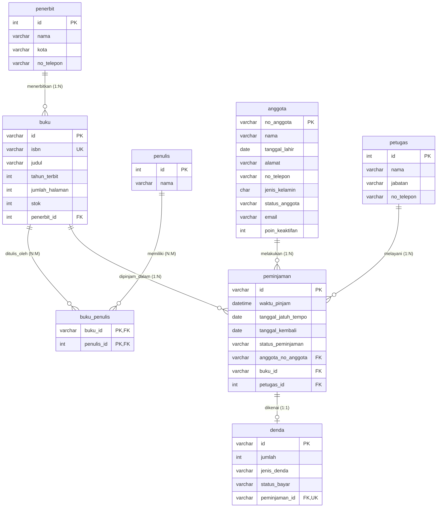

# Dokumentasi Pengerjaan Tugas Sistem Basis Data
## Modul Pendahuluan 2 - Basis Data Perpustakaan (`perpustakaan_its`)

Dokumentasi ini menyajikan panduan lengkap, struktur skema, dan penjelasan setiap tahap pengerjaan script SQL pada **Modul Pendahuluan 2 - Sistem Basis Data**. Seluruh tahapan dirancang untuk mengimplementasikan konsep *Data Definition Language* (DDL), *Data Manipulation Language* (DML), integritas referensial (*referential integrity*), serta modifikasi struktur tabel pada basis data perpustakaan.

---

##  Informasi Proyek

| Informasi | Keterangan |
| :--- | :--- |
| **Mata Kuliah** | Sistem Basis Data |
| **Topik Modul** | Modul Pendahuluan 2 - DDL, DML, Constraint & Integritas Relasi |
| **Nama Database** | `perpustakaan_its` |
| **DBMS** | MySQL / MariaDB |
| **Storage Engine** | InnoDB (Mendukung ACID & Foreign Key Constraints) |

---

##  Struktur Direktori File

Proyek ini terdiri dari file-file SQL modular yang merepresentasikan tahapan eksekusi:

```text
modul2-perpus/
├── tahap1.sql          # Pembuatan database, tabel, primary key, & foreign key
├── tahap2.sql          # Pengisian data awal (INSERT)
├── tahap3.sql          # Penambahan kolom email & poin_keaktifan pada tabel anggota
├── tahap4.sql          # Modifikasi tipe/panjang kolom no_telepon pada tabel penerbit
├── tahap5.sql          # Penghapusan kolom negara_asal pada tabel penulis
├── tahap6.sql          # Penambahan constraint UNIQUE pada isbn buku
├── tahap7.sql          # Penambahan data transaksi denda
├── tahap8.sql          # Update pengembalian peminjaman (PJ0002)
├── tahap9.sql          # Update nomor telepon anggota
├── tahap10.sql         # Update status bayar denda (DN0003)
├── tahap11.sql         # Hapus data buku (BK0005) & pengujian CASCADE
├── tahap12.sql         # Hapus data peminjaman yang sudah selesai & pengujian CASCADE
├── tahapcektabel.sql   # Query verifikasi struktur tabel dan integritas data
└── README.md           # Dokumentasi lengkap pengerjaan
```

---

##  Skema Relasi Basis Data (ERD Relasional)

Berikut merupakan hubungan antar entitas di dalam database `perpustakaan_its`:



### Karakteristik Relasi:
1. **Many-to-Many (`penulis` & `buku`)**: Dihubungkan melalui tabel perantara (*junction table*) `buku_penulis` dengan *composite primary key* `(buku_id, penulis_id)`.
2. **One-to-One (`peminjaman` & `denda`)**: Diterapkan dengan memasang kolom `peminjaman_id` bertipe *Foreign Key* yang memiliki constraint `UNIQUE` pada tabel `denda`.
3. **Integritas Referensial**: Seluruh relasi *foreign key* menggunakan aksi referensial `ON UPDATE CASCADE ON DELETE CASCADE`.

---

## 🛠️ Rincian Pengerjaan Tiap Tahap

### Tahap 1: Pembuatan Database & Skema Tabel
* **File:** [`tahap1.sql`](file:///Users/aprianto/Documents/projek/sbd/modul2-perpus/tahap1.sql)
* **Tujuan:** Membuat basis data `perpustakaan_its` serta 8 tabel utama lengkap dengan batasan kunci (*Primary Key* dan *Foreign Key*).
* **Fitur Utama:**
  * Engine `InnoDB` untuk memastikan dukungan transaksi dan *foreign key*.
  * Constraint `fk_buku_penerbit`, `fk_buku_penulis_buku`, `fk_buku_penulis_penulis`, `fk_peminjaman_anggota`, `fk_peminjaman_buku`, `fk_peminjaman_petugas`, dan `fk_denda_peminjaman`.
  * Kebijakan `ON UPDATE CASCADE ON DELETE CASCADE` agar perubahan atau penghapusan data induk otomatis tersinkronisasi ke data turunan.

```sql
CREATE DATABASE perpustakaan_its;
USE perpustakaan_its;

-- Contoh pembuatan tabel peminjaman
CREATE TABLE peminjaman (
    id VARCHAR(10) PRIMARY KEY,
    waktu_pinjam DATETIME NOT NULL,
    tanggal_jatuh_tempo DATE NOT NULL,
    tanggal_kembali DATE NULL,
    status_peminjaman VARCHAR(20) NOT NULL,
    anggota_no_anggota VARCHAR(20) NOT NULL,
    buku_id VARCHAR(10) NOT NULL,
    petugas_id INT NOT NULL,
    CONSTRAINT fk_peminjaman_anggota FOREIGN KEY (anggota_no_anggota) REFERENCES anggota(no_anggota) ON UPDATE CASCADE ON DELETE CASCADE,
    CONSTRAINT fk_peminjaman_buku FOREIGN KEY (buku_id) REFERENCES buku(id) ON UPDATE CASCADE ON DELETE CASCADE,
    CONSTRAINT fk_peminjaman_petugas FOREIGN KEY (petugas_id) REFERENCES petugas(id) ON UPDATE CASCADE ON DELETE CASCADE
) ENGINE = InnoDB;
```

---

### Tahap 2: Pengisian Data Awal (DML INSERT)
* **File:** [`tahap2.sql`](file:///Users/aprianto/Documents/projek/sbd/modul2-perpus/tahap2.sql)
* **Tujuan:** Memasukkan data master dan data relasi awal ke dalam sistem:
  * **4 Penerbit:** Gramedia Pustaka Utama, Bentang Pustaka, Informatika Bandung, Lentera Dipantara.
  * **5 Penulis:** Andrea Hirata, Pramoedya Ananta Toer, Tere Liye, Rinaldi Munir, Leoni Lidya.
  * **5 Buku:** *Laskar Pelangi*, *Bumi Manusia*, *Bumi*, *Algoritma dan Pemrograman*, *Sang Pemimpi*.
  * **Relasi Buku-Penulis:** Mengakomodasi buku dengan satu penulis maupun *multiple authors* (contoh: *Algoritma dan Pemrograman* ditulis oleh Rinaldi Munir dan Leoni Lidya).
  * **5 Anggota:** Data mahasiswa ITS (`5026231001` - `5026231005`).
  * **3 Petugas:** Pustakawan, Staf Sirkulasi, dan Staf Katalog.
  * **6 Transaksi Peminjaman:** (`PJ0001` - `PJ0006`) dengan variasi status (`Dikembalikan`, `Terlambat`, `Dipinjam`).

---

### Tahap 3: Menambah Kolom Baru pada Tabel Anggota
* **File:** [`tahap3.sql`](file:///Users/aprianto/Documents/projek/sbd/modul2-perpus/tahap3.sql)
* **Tujuan:** Menambahkan kolom `email` dan `poin_keaktifan` untuk mendukung fitur notifikasi dan program loyalitas anggota perpustakaan.
* **Sintaks:**
```sql
ALTER TABLE anggota
ADD COLUMN email VARCHAR(100),
ADD COLUMN poin_keaktifan INT NOT NULL DEFAULT 0;
```

---

### Tahap 4: Modifikasi Definisi Kolom pada Tabel Penerbit
* **File:** [`tahap4.sql`](file:///Users/aprianto/Documents/projek/sbd/modul2-perpus/tahap4.sql)
* **Tujuan:** Mempertegas dan memodifikasi atribut kolom `no_telepon` pada tabel `penerbit`.
* **Sintaks:**
```sql
ALTER TABLE penerbit
MODIFY COLUMN no_telepon VARCHAR(20) NOT NULL;
```

---

### Tahap 5: Menghapus Kolom pada Tabel Penulis
* **File:** [`tahap5.sql`](file:///Users/aprianto/Documents/projek/sbd/modul2-perpus/tahap5.sql)
* **Tujuan:** Menghapus atribut `negara_asal` dari entitas `penulis` yang tidak lagi digunakan dalam kebutuhan skema.
* **Sintaks:**
```sql
ALTER TABLE penulis
DROP COLUMN negara_asal;
```

---

### Tahap 6: Menambahkan Constraint UNIQUE pada ISBN Buku
* **File:** [`tahap6.sql`](file:///Users/aprianto/Documents/projek/sbd/modul2-perpus/tahap6.sql)
* **Tujuan:** Menjamin keunikan nomor ISBN pada tabel `buku` sehingga tidak ada buku berbeda yang memiliki ISBN identik.
* **Sintaks:**
```sql
ALTER TABLE buku
ADD CONSTRAINT uq_buku_isbn UNIQUE (isbn);
```

---

### Tahap 7: Pengisian Data Transaksi Denda
* **File:** [`tahap7.sql`](file:///Users/aprianto/Documents/projek/sbd/modul2-perpus/tahap7.sql)
* **Tujuan:** Menambahkan data denda keterlambatan terhadap transaksi peminjaman yang berstatus terlambat (`PJ0002`, `PJ0003`, dan `PJ0006`).
* **Sintaks:**
```sql
INSERT INTO denda
    (id, jumlah, jenis_denda, status_bayar, peminjaman_id)
VALUES
    ('DN0001', 5000, 'Terlambat', 'Belum Lunas', 'PJ0002'),
    ('DN0002', 2000, 'Terlambat', 'Belum Lunas', 'PJ0003'),
    ('DN0003', 3000, 'Terlambat', 'Belum Lunas', 'PJ0006');
```

---

### Tahap 8: Pembaruan Data Peminjaman (UPDATE Transaksi)
* **File:** [`tahap8.sql`](file:///Users/aprianto/Documents/projek/sbd/modul2-perpus/tahap8.sql)
* **Tujuan:** Mengubah status peminjaman `PJ0002` setelah buku dikembalikan oleh peminjam pada tanggal `2026-10-12`.
* **Sintaks:**
```sql
UPDATE peminjaman
SET
    tanggal_kembali = '2026-10-12',
    status_peminjaman = 'Dikembalikan'
WHERE id = 'PJ0002';
```

---

### Tahap 9: Pembaruan Data Anggota (UPDATE Kontak)
* **File:** [`tahap9.sql`](file:///Users/aprianto/Documents/projek/sbd/modul2-perpus/tahap9.sql)
* **Tujuan:** Memperbarui kontak nomor telepon milik anggota dengan nomor anggota `5026231001`.
* **Sintaks:**
```sql
UPDATE anggota
SET no_telepon = '081223344556'
WHERE no_anggota = '5026231001';
```

---

### Tahap 10: Pembaruan Data Denda (UPDATE Pembayaran)
* **File:** [`tahap10.sql`](file:///Users/aprianto/Documents/projek/sbd/modul2-perpus/tahap10.sql)
* **Tujuan:** Memperbarui status pembayaran denda `DN0003` menjadi `Lunas`.
* **Sintaks:**
```sql
UPDATE denda
SET status_bayar = 'Lunas'
WHERE id = 'DN0003';
```

---

### Tahap 11: Penghapusan Buku & Pengujian Relasi CASCADE
* **File:** [`tahap11.sql`](file:///Users/aprianto/Documents/projek/sbd/modul2-perpus/tahap11.sql)
* **Tujuan:** Menghapus buku dengan id `BK0005` (*Sang Pemimpi*).
* **Dampak Integritas (*CASCADE Effect*):**
  * Data relasi pada tabel perantara `buku_penulis` dengan `buku_id = 'BK0005'` otomatis terhapus.
  * Data peminjaman `PJ0004` yang meminjam `BK0005` otomatis ikut terhapus karena aturan `ON DELETE CASCADE`.
* **Sintaks:**
```sql
DELETE FROM buku
WHERE id = 'BK0005';
```

---

### Tahap 12: Pembersihan Data Peminjaman Selesai
* **File:** [`tahap12.sql`](file:///Users/aprianto/Documents/projek/sbd/modul2-perpus/tahap12.sql)
* **Tujuan:** Menghapus seluruh data riwayat peminjaman yang berstatus `'Dikembalikan'`.
* **Dampak Integritas (*CASCADE Effect*):**
  * Transaksi `PJ0001`, `PJ0002`, dan `PJ0003` terhapus.
  * Data denda terkait pada tabel `denda` (`DN0001` untuk `PJ0002` dan `DN0002` untuk `PJ0003`) otomatis ikut terhapus.
* **Sintaks:**
```sql
DELETE FROM peminjaman
WHERE status_peminjaman = 'Dikembalikan';
```

---

### Tahap Pengecekan & Verifikasi Basis Data
* **File:** [`tahapcektabel.sql`](file:///Users/aprianto/Documents/projek/sbd/modul2-perpus/tahapcektabel.sql)
* **Tujuan:** Memvalidasi seluruh struktur tabel, constraint yang aktif, serta sisa data yang tersimpan di dalam basis data setelah manipulasi tahap 1-12 dijalankan.
* **Sintaks yang Digunakan:**
```sql
-- Memeriksa seluruh tabel yang terbentuk
SHOW TABLES;

-- Memeriksa perubahan struktur kolom anggota, penerbit, dan penulis
DESCRIBE anggota;
DESCRIBE penerbit;
DESCRIBE penulis;

-- Memeriksa definisi tabel buku beserta constraint unik & foreign key
SHOW CREATE TABLE buku;

-- Memeriksa data akhir pada tabel-tabel utama
SELECT * FROM buku;
SELECT * FROM anggota;
SELECT * FROM peminjaman;
SELECT * FROM denda;
```


##  Konsep yang Diterapkan

| Konsep | Implementasi dalam Proyek |
| :--- | :--- |
| **DDL (Data Definition Language)** | Pembuatan database (`CREATE DATABASE`), tabel (`CREATE TABLE`), serta modifikasi struktur (`ALTER TABLE` - `ADD`, `MODIFY`, `DROP COLUMN`, `ADD CONSTRAINT`). |
| **DML (Data Manipulation Language)** | Penambahan data (`INSERT INTO`), pembaruan record data (`UPDATE`), dan penghapusan data (`DELETE FROM`). |
| **Composite Primary Key** | Diterapkan pada junction table `buku_penulis (buku_id, penulis_id)` untuk menangani relasi *Many-to-Many*. |
| **Unique Foreign Key** | Diterapkan pada `denda(peminjaman_id)` yang bersifat `UNIQUE` untuk merepresentasikan hubungan *One-to-One* (satu peminjaman maksimal memiliki satu denda). |
| **Referential Integrity Actions** | Penggunaan `ON UPDATE CASCADE ON DELETE CASCADE` menjamin tidak adanya *orphan record* pada tabel turunan ketika data induk dimodifikasi atau dihapus. |
| **Data Integrity Constraint** | Menjamin validitas entri dengan `NOT NULL`, `DEFAULT`, dan `UNIQUE`. |
